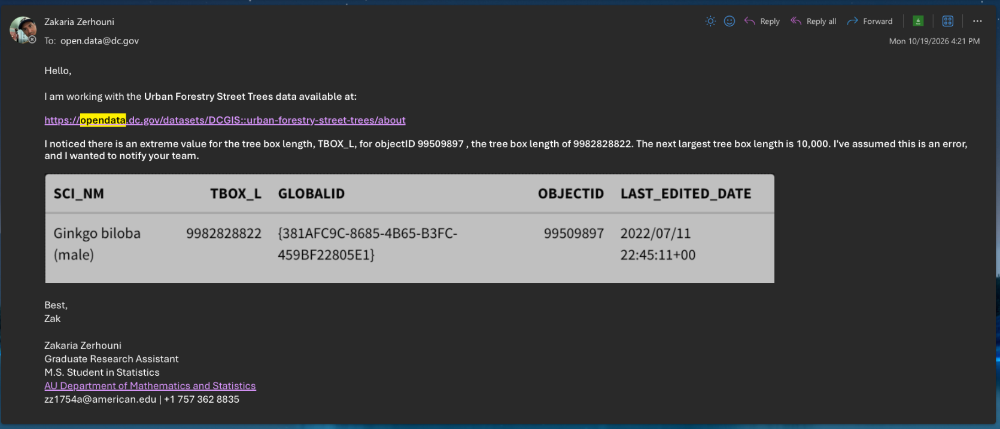

# Setup

## Data Source

Our data is retrieved from 

https://opendata.dc.gov/datasets/DCGIS::urban-forestry-street-trees/about

## Loading required packages

```{r}
#| label: load-library-chunk
#| output: FALSE
#| warning: FALSE
#| echo: TRUE
invisible(lapply(c("tidyverse", "class", "MASS"), library, character.only=TRUE))
```

## Custom Functions 

```{r}
#| label: plothist-function
#| #| echo: TRUE
plothist <- function(variable.string,dataframe,xAxisLabel, title=NULL) {
  var.sd <- sd(dataframe[,variable.string][[1]], na.rm=TRUE)
  var.filtered <- dataframe %>% dplyr::select(all_of(variable.string)) %>% filter(.data[[variable.string]] < 3*var.sd) %>% pull(.data[[variable.string]])
  return(hist(var.filtered, xlab = xAxisLabel, main = title))
}
```

## Loading the data into the R environment

```{r}
#| echo: TRUE
#| label: read-forestry-csv-chunk
forestry.all <- read_csv(file = "../01_EDA/data/Urban_Forestry_Street_Trees.csv", col_select = c(-36,-37,-40))
```


## Dictionary

```{r}
#| echo: TRUE
#| label: load-dictionary-csv-chunk
dictionary <- read_csv("../01_EDA/data/forest_dictionary.csv")
```

## Column Name Partition

```{r}
#| label: list-numeric-variables
#| echo: true
#| output: true
# numeric columns
numeric.variables <- forestry.all |> select_if(is.numeric) |> colnames()
numeric.variables
```

```{r}
#| label: list-nonnumeric-variables
#| echo: true
#| output: true
# non-numeric columns
nonnumeric.variables <- forestry.all %>% dplyr::select(where(~ !is.numeric(.))) %>% colnames()
nonnumeric.variables
```

```{r}
#| label: store-numeric-variables
forestry.all |> dplyr::select_if(is.numeric) -> forestry.numeric
```

```{r}
#| label: view-numeric-dictionary
#| execute: false
#| include: false
#| error: false
#| echo: false
#| eval: false
View(filter(dictionary, Label %in% numeric.variables))
```


```{r}
numeric.subset <- numeric.variables[4:(length(numeric.variables)-1)]
numeric.subset
```

# Variables
## Numeric Variables

### TBOX_W and TBOX_L

TBOX_W

Tree box width

TBOX_L

Tree box length


```{r}
# There is an extreme value that does not make sense
# After contacting DC's open data provider, they stated that they corrected the
# value in the online database.
max(forestry.all$TBOX_L, na.rm = TRUE)
match(max(forestry.all$TBOX_L, na.rm=TRUE),forestry.all$TBOX_L)
forestry.all[109328,]
```

```{r}
# subset() function to remove erroneous data point (or update with correction from DC urban forestry)
```

```{r}
#| label: tbox_l-tbox_w-histograms
#| include: true
#| output: true
#| echo: true
par(mfrow=c(1,2))
# TBOX_W Histogram
tboxw.sd <- sd(forestry.all[,"TBOX_W"][[1]],na.rm=TRUE)

tboxw.filtered <- forestry.all %>% dplyr::select(TBOX_W) %>% filter(TBOX_W < 3*tboxw.sd) %>% pull(TBOX_W)
hist(tboxw.filtered, xlab = "Tree Box Width")
# TBOX_L Histogram
# The point 109328 is actually an erroneous value for a tree box on the order of 10^9
tboxl.sd <- sd(forestry.all[,"TBOX_L"][[1]][-109328],na.rm=TRUE)
tboxl.filtered <- forestry.all %>% dplyr::select(TBOX_L) %>% filter(TBOX_L < 3*tboxl.sd) %>% pull(TBOX_L)
hist(tboxl.filtered, xlab = "Tree Box Length")
```

```{r}
# We have a negative value for diameter at breast height
min(forestry.all$DBH, na.rm=TRUE)
match(min(forestry.all$DBH, na.rm=TRUE), forestry.all$DBH)
```

### DBH

DBH

Diameter at breast height (This tree girth is commonly measured at 4.5 feet from the soil surface.)

```{r}
#| label: dbh-hist
#| output: true
#| echo: true
# DBH Histogram
dbh.sd <- sd(forestry.all[,"DBH"][[1]],na.rm=TRUE)
dbh.filtered <- forestry.all %>% dplyr::select(DBH) %>% filter(DBH < 3*dbh.sd & DBH >= 0) %>% pull(DBH)
hist(dbh.filtered, xlab = "Diameter at Breast Height")
```

### MBG_W and MBG_L

MBG_WIDTH

The horizontal measurement of a tree's foliage and branches, usually defined as the average distance between the outermost driplines on opposite sides of the tree. It serves as a key indicator of tree vigor, competitive capacity, and canopy closure in forestry and ecological studies. Measurements are in feet and were derived from 2020 lidar data.

MBG_LENGTH

The vertical measurement of a tree from the top (highest live foliage) down to the base of the live crown, typically defined as the lowest, non-epicormic, live branch. It represents the active, photosynthetic portion of the tree, indicating its health, vigor, and capacity for growth. Measurements are in feet and were derived from 2020 lidar data.

```{r}
#| label: mbg_w-mbg_l-histograms
#| include: true
#| output: true
#| echo: true
par(mfrow=c(1,2))
# MBG_WIDTH Histogram
mbgw.sd <- sd(forestry.all[,"MBG_WIDTH"][[1]],na.rm=TRUE)
mbgw.filtered <- forestry.all %>% dplyr::select(MBG_WIDTH) %>% filter(MBG_WIDTH < 3*mbgw.sd) %>% pull(MBG_WIDTH)
hist(mbgw.filtered, xlab = "Horiz Branch & Foliage Growth (MBG W)")
# MBG_LENGTH Histogram
mbgl.sd <- sd(forestry.all[,"MBG_LENGTH"][[1]],na.rm=TRUE)
mbgl.filtered <- forestry.all %>% dplyr::select(MBG_LENGTH) %>% filter(MBG_LENGTH < 3*mbgl.sd) %>% pull(MBG_LENGTH)
hist(mbgl.filtered, xlab = "Vert Dist Min Live branch to Apex (MBG L)")
```

### Max Crown Height

MAX_CROWN_HEIGHT

The vertical distance from the base of the lowest live, sustainable branch to the absolute highest point (apex) of a tree. It represents the total vertical extent of the photosynthetic canopy, excluding dead lower branches, and serves as an indicator of tree vigor, health, and age. Measurements are in feet and were derived from 2020 lidar data.

```{r}
#| output: true
#| echo: true
# There is a negative value in the MAX_CROWN_HEIGHT
min(forestry.all$MAX_CROWN_HEIGHT, na.rm=TRUE)
match(min(forestry.all$MAX_CROWN_HEIGHT, na.rm=TRUE), forestry.all$MAX_CROWN_HEIGHT)
```


```{r}
#| label: max-crown-hist
#| output: true
#| echo: true
# DBH Histogram
maxcrown.sd <- sd(forestry.all[,"MAX_CROWN_HEIGHT"][[1]],na.rm=TRUE)
maxcrown.filtered <- forestry.all %>% dplyr::select(MAX_CROWN_HEIGHT) %>% filter(MAX_CROWN_HEIGHT < 3*maxcrown.sd & MAX_CROWN_HEIGHT > 0) %>% pull(MAX_CROWN_HEIGHT)
hist(maxcrown.filtered, xlab = "Max Crown Height", main = "Histogram of MAX_CROWN_HEIGHT")
```

### Max Mean

"MAX_MEAN"

The average vertical distance from the base of the live crown (lowest live branches) to the top of the tree, representing the average vertical extent of the foliage across a sample. It indicates tree vigor, shading capability, and competition for light, with larger crowns often signifying better health. Measurements are in feet and were derived from 2020 lidar data.

```{r}
#| output: true
#| echo: true
# There is a negative value in the MAX_MEAN variable
min(forestry.all$MAX_MEAN, na.rm=TRUE)
match(min(forestry.all$MAX_MEAN, na.rm=TRUE), forestry.all$MAX_MEAN)
```

```{r}
#| label: max-mean-hist
#| output: true
#| echo: true
# Max Mean Histogram
maxmean.sd <- sd(forestry.all[,"MAX_MEAN"][[1]],na.rm=TRUE)
maxmean.filtered <- forestry.all %>% dplyr::select(MAX_MEAN) %>% filter(MAX_MEAN < 3*maxmean.sd & MAX_MEAN > 0) %>% pull(MAX_MEAN)
hist(maxmean.filtered, xlab = "Max Crown Height")
```


### Min Crown Base

MIN_CROWN_BASE

The vertical distance from the ground to the lowest continuous, living branch or foliage whorl on the main stem. It signifies the starting point of the tree's productive canopy, excluding epicormic sprouts and lower, dying branches. Measurements are in feet and were derived from 2020 lidar data.

```{r}
#| label: min-crown-base-hist
#| output: true
#| echo: true
# MIN_CROWN_BASE Histogram
plothist("MIN_CROWN_BASE",forestry.all,xAxisLabel = "Vert Dist from Ground to Live Main Stem", title="Histogram of MIN_CROWN_BASE")
```


### DTM Mean

DTM_MEAN

Refers to the specific point where the base of a tree’s trunk (the root collar) meets the surrounding ground surface. This measurement serves as the baseline for determining total tree height, typically measured from the ground up to the highest living branch. Measurements are in feet and were derived from 2020 lidar data.

```{r}
#| label: dtm-mean-hist
#| output: true
#| echo: true
# MIN_CROWN_BASE Histogram
plothist("DTM_MEAN",forestry.all,xAxisLabel = "Root Collar Meets Ground Surface", title="Histogram of DTM Mean")
```

### PERIM

PERIM

The outermost boundary of a tree's branches and foliage projected onto the ground. It represents the total horizontal width or extent of the canopy, commonly measured by identifying the widest diameter and a second diameter at 90 degrees. Measurements are in feet and were derived from 2020 lidar data.

```{r}
#| label: perim-hist
#| output: true
#| echo: true
# MIN_CROWN_BASE Histogram
plothist("PERIM",forestry.all,xAxisLabel = "Projection of Tree Outer Boundary", title="Histogram of PERIM")
```

### Crown Area

CROWN_AREA

The upper, leafy portion of a tree comprising branches, foliage, and reproductive parts extending from the main trunk. As the primary site for photosynthesis, it acts as the interface for light, water, and gas exchange, with its spread often measured to the outer dripline. Measurements are in square feet and were derived from 2020 lidar data.

```{r}
#| label: crown-area-hist
#| output: true
#| echo: true
# MIN_CROWN_BASE Histogram
plothist("CROWN_AREA",forestry.all,xAxisLabel = "Crown Area: Leafy Upper Portion of Tree", title="Histogram of CROWN_AREA")
```


## Nonnumeric Variables

### Nonnumeric Column Names

```{r}
nonnumeric.variables
```

```{r}
# Time of planting
forestry.all |> 
  dplyr::select(DATE_PLANT) |> 
  filter(!is.na(DATE_PLANT)) |>
  mutate(datetimePlant = ymd_hms(DATE_PLANT)) |> arrange(datetimePlant)
```


```{r}
forestry.all |> dplyr::select(RETIREDDT) |> filter(!is.na(RETIREDDT))
```

```{r}
forestry.all |> dplyr::select(CONDITION) |> filter(CONDITION == "Dead")
```

```{r}
forestry.all |> dplyr::select(CONDITION) |> filter(is.na(CONDITION))
```


```{r}
nrow(forestry.all)
```


```{r}
forestry.all$OBJECTID |> unique() |> length()
```


### Condition

```{r}
#| include: true
#| echo: true
#| eval: true
forestry.all |> dplyr::select(CONDITION) |> unique()
```

```{r}
#| include: true
#| echo: true
#| eval: true
forestry.all |> dplyr::select(CONDITION) |> filter(!is.na(CONDITION)) |> nrow()
```

```{r}
forestry.all |> pull(CONDITION) |> table()
```


# Model Selection

## Data Subsetting and Simplification

The data is simplified to have no NAs to test the execution of the models we have selected. Ideally missing data will be imputed with the Multiple Imputation with Chained Equations function from the `mice` package.

```{r}
#| include: true
#| echo: true
#| eval: true
forestry.all |> dplyr::select(DBH, MBG_WIDTH, MBG_LENGTH, TBOX_L, TBOX_W, MAX_CROWN_HEIGHT, MAX_MEAN, MIN_CROWN_BASE, DTM_MEAN, PERIM, CONDITION) |>  summarise(across(everything(), ~ sum(is.na(.))))
```

```{r}
#| include: true
#| echo: true
#| eval: true
# Create forestry.initital data frame
forestry.all |> dplyr::select(CONDITION, DBH, MBG_WIDTH, MBG_LENGTH, TBOX_L, TBOX_W, MAX_CROWN_HEIGHT, MAX_MEAN, MIN_CROWN_BASE, DTM_MEAN, PERIM) |> drop_na() |> relocate(CONDITION) -> forestry.initial
```

```{r, cache=TRUE}
#| label: initial-pairs-plot-1
#| output: true
#| echo: true
GGally::ggpairs(forestry.initial[2:5], progress=FALSE)
```

```{r, cache=TRUE}
#| label: initial-pairs-plot-2
#| output: true
#| echo: true
GGally::ggpairs(forestry.initial[5:8], progress=FALSE)
```

```{r, cache=TRUE}
#| label: initial-pairs-plot-3
#| output: true
#| echo: true
GGally::ggpairs(forestry.initial[,c(1,9,10,11)], progress=FALSE)
```

```{r, cache=TRUE}
#| label: pairs-all-forestry.initial
#| eval: FALSE
pairs(forestry.initial[2:11])
```


```{r}
forestry.initial[,1] |> head()
```

```{r}
table(forestry.initial$CONDITION)
```


```{r}
str(forestry.initial)
```

## KNN

We try a simplified attempt at KNN classification on the data.

```{r, cache = TRUE}
#| label: initial-knn-condition
#| output: true
#| echo: true

# KNN implemenation from homework

set.seed(1234)

training_pct <- 0.70

Z <- sample(nrow(forestry.initial), floor(training_pct*nrow(forestry.initial)))

Xtrain_unscaled <- as.data.frame(forestry.initial[Z, 2:ncol(forestry.initial)])

Xtrain <- as.data.frame(scale(Xtrain_unscaled))  # Our training set X

Ytrain <- forestry.initial$CONDITION[Z] # Our training set y

Xtest_unscaled <- forestry.initial[-Z, 2:ncol(forestry.initial)]

Xtest <- Xtest_unscaled

for (j in 1:ncol(Xtest)){
  Xtest[, j] <- (Xtest_unscaled[, j] - mean(Xtrain_unscaled[, j]))/sd(Xtrain_unscaled[, j])
}

Yhat <- class::knn(Xtrain, Xtest, Ytrain, k = 9)

Ytest <- forestry.initial$CONDITION[-Z]

conf_matrix <- table(Ytest, Yhat)
conf_matrix
```


## LDA

A simplified attempt at LDA is implemented accodring to our prior homework asisgnment.

```{r, cache = TRUE}
#| label: initial-lda-condition
#| output: true
#| echo: true
set.seed(1234)

train.ratio = 7/10

sample.index = sample(x = 1:nrow(forestry.initial), size = floor(train.ratio*nrow(forestry.initial)))

forestry.initial.train <- forestry.initial[sample.index,]
forestry.initial.test <- forestry.initial[-sample.index,]

lda.training.model <- lda(CONDITION ~ . - CONDITION, data = forestry.initial.train)

lda.predictions <- predict(lda.training.model, newdata = forestry.initial.test)

table(forestry.initial.test$CONDITION,lda.predictions$class)
```

## QDA

A simplified QDA model is implemented as a proof of concept.

```{r, cache = TRUE}
#| label: initial-qda-condition
#| output: true
#| echo: true
qda.training.model <- qda(CONDITION ~ . - CONDITION, data = forestry.initial.train)

qda.predictions <- predict(qda.training.model, newdata = forestry.initial.test)

table(forestry.initial.test$CONDITION,qda.predictions$class)
```

## Logistic Regression

If the condition variable is simplified to a binary outcome we can implement a logistic regression to test the quality of the results.

This would require placing the fair status either in the Good/Excellent category, or the Poor/Dead category. We could attempt to tune our model by seeing which of these category assignemnts leads to a better classification as well.


# Appendix



